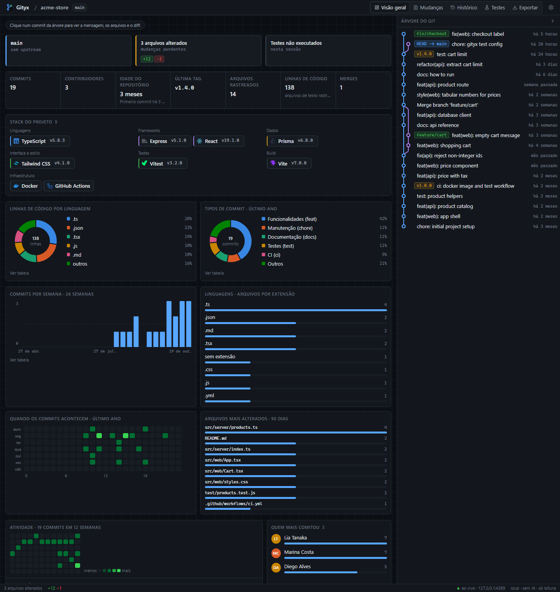
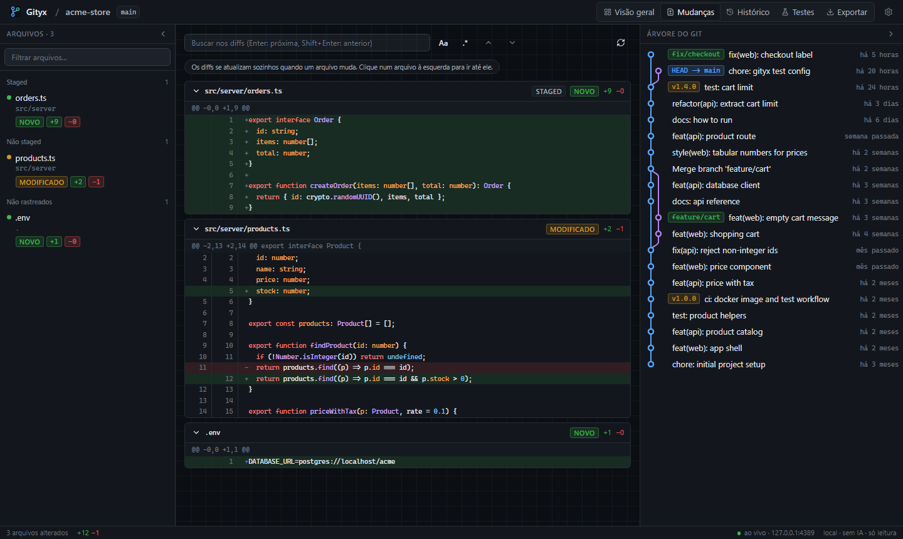
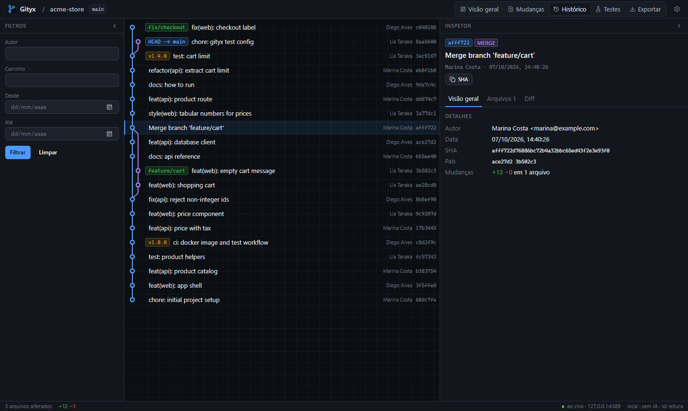
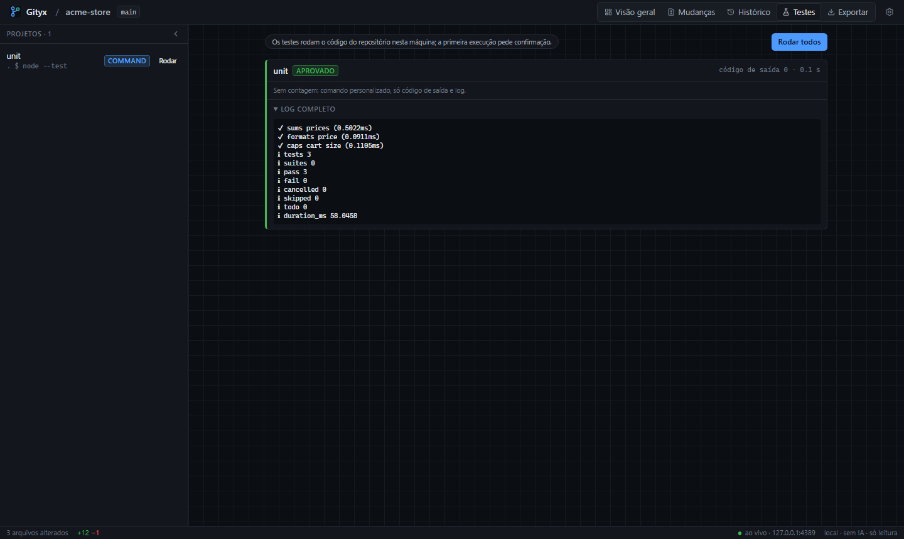
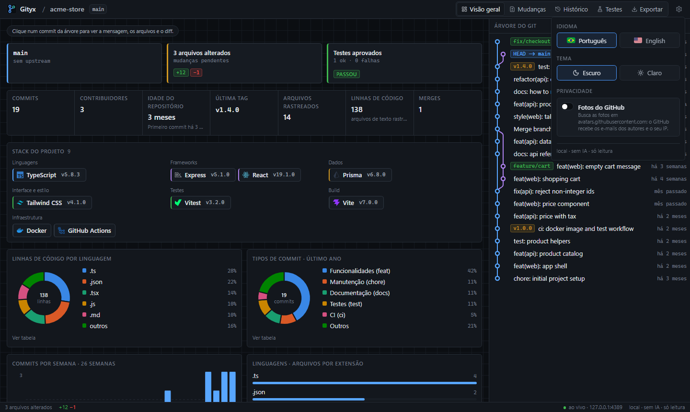
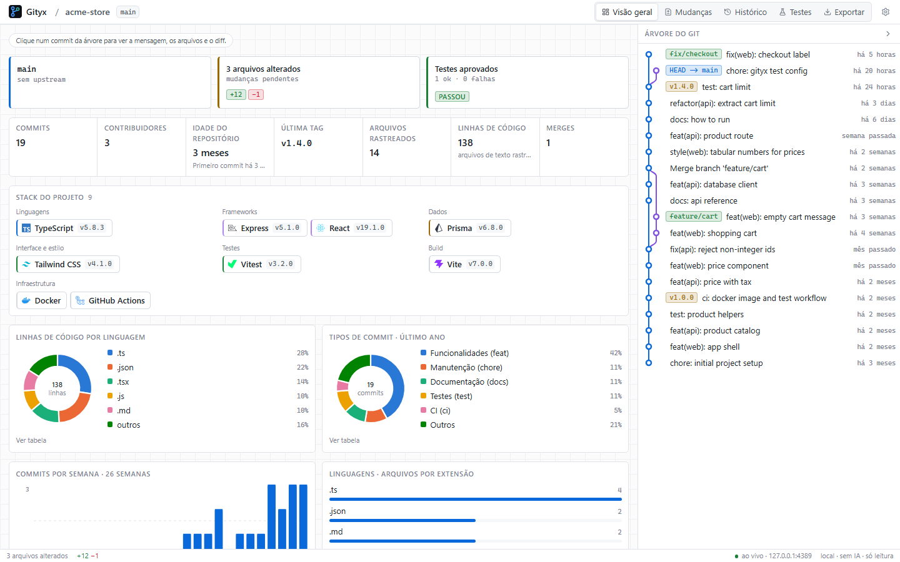
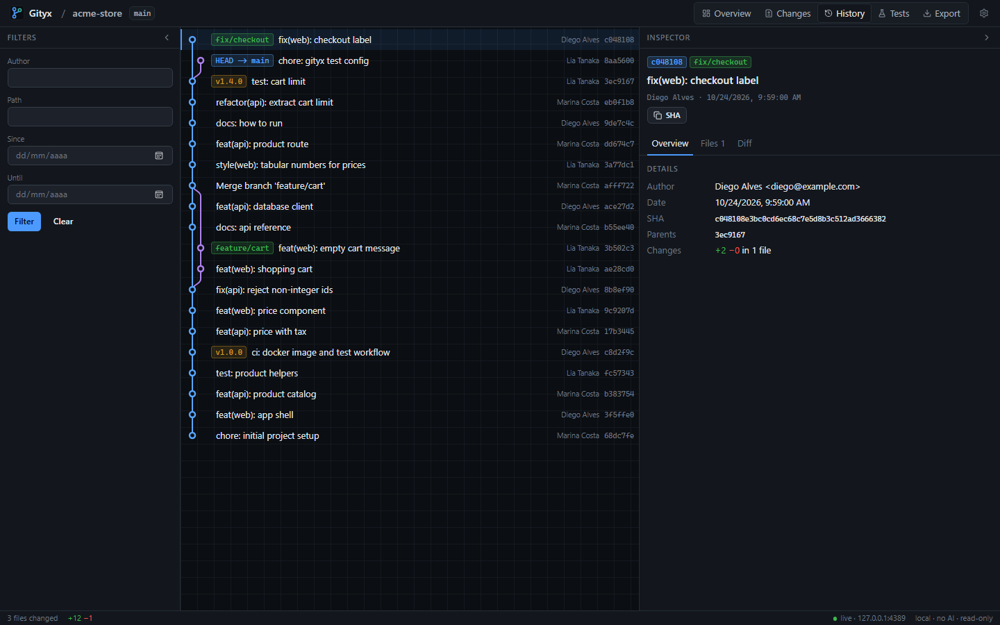

<p align="center">
  
</p>

<h1 align="center">Gityx</h1>

<p align="center">
  <b>English</b> · <a href="README.pt-BR.md">Português (Brasil)</a>
</p>

<p align="center">
  Your repository's Git in the browser: commit graph, live changes, stats and tests. It runs on your machine, without AI, and never writes to the repository.
</p>

<p align="center">
  
  
  
  
  
  
  
</p>

<p align="center">
  
</p>

> [!NOTE]
> **Nothing leaves your machine.** The server listens on `127.0.0.1` only, the page needs a random token, and there is no telemetry, CDN or remote font. The one exception is opt-in: the **GitHub photos** setting loads avatars from `avatars.githubusercontent.com`.

> [!WARNING]
> **Tests run your repository's code.** Gityx asks for confirmation before the first run of each session, but a test suite can still do anything your user can do.

## Features

- **Overview**: branch and upstream, pending changes, last test run, and the numbers of the project (commits, contributors, age, latest tag, tracked files, lines of code, merges).
- **Project stack**: languages, frameworks, data, UI, tests, build and infrastructure detected from `package.json`, `go.mod`, `requirements.txt`/`pyproject.toml`, `Cargo.toml`, `composer.json`, `Gemfile`, `pom.xml`/Gradle, `.csproj`, Dockerfile, compose and GitHub Actions, each with its icon and version.
- **Charts**: lines of code by language, commit types (`feat`, `fix`, `docs`…), commits per week, files by extension, most changed files, when commits happen (weekday × hour), a 12-week activity calendar and the top committers. Every chart has a tooltip and a table view.
- **Git tree**: every branch with tags, `HEAD` and merges. Click a commit to open it.
- **Changes**: staged, unstaged and untracked diffs that update by themselves, with syntax highlighting and search by text or regex.
- **History**: the full graph with filters by author, path and date, and an inspector with details, files and diff.
- **Tests**: Jest, Vitest, the `test` script, Go, pytest, cargo, dotnet, Maven, Gradle, PHPUnit and RSpec are found automatically; any other command goes in `.gityx.json`.
- **Export**: HTML (a single offline file), Markdown or JSON. Sensitive files (`.env`, keys, tokens) show only their name unless you include them.
- **Settings**: English and Portuguese (Brazil), dark and light themes, and the opt-in GitHub photos.

## Screenshots

**Changes**: files grouped by state on the left, live diffs in the middle, the Git tree on the right.

<p align="center"></p>

**History**: filters, the full graph and the commit inspector.

<p align="center"></p>

**Tests**: projects on the left, the run with its status and full log.

<p align="center"></p>

**Settings**: language, theme and privacy in one place.

<p align="center"></p>

**Light theme** and **English**:

<p align="center">
  
  
</p>

## Getting started

All you need is [Node.js](https://nodejs.org) **20.19 or newer** and `git` on your `PATH`.

```sh
git clone https://github.com/SamuelSchutz13/Gityx.git
cd Gityx
npm install
npm run build
npm link          # makes the `gityx` command available everywhere
```

Then, inside any Git repository:

```sh
cd ~/some-repository
gityx                          # starts the server and opens the browser
gityx --port 8080 --open=false
gityx ../another-repository
```

The terminal prints a URL like `http://127.0.0.1:54321/?t=…`. Press **Ctrl+C** to stop. Once the package is published to npm, `npx gityx` will do the same without cloning.

> [!TIP]
> After updating Gityx, stop the server and start it again: the security headers come from the server, so reloading the page is not enough.

### Configuration

Optional, in `.gityx.json` at the repository root:

```json
{
  "tests": {
    "timeout": "5m",
    "projects": [
      { "name": "api", "kind": "go", "dir": "backend" },
      { "name": "web", "kind": "node", "dir": "web" },
      { "name": "e2e", "kind": "command", "dir": ".", "command": ["npm", "run", "test:e2e"] }
    ]
  }
}
```

| Field                      | Description                                                                           |
| -------------------------- | ------------------------------------------------------------------------------------- |
| `tests.timeout`            | Per project, as `500ms`, `30s`, `5m` or `1h` (default `10m`)                          |
| `tests.projects[].kind`    | `node` (Jest, Vitest or the `test` script), `go`, or `command`                        |
| `tests.projects[].dir`     | Folder inside the repository                                                          |
| `tests.projects[].command` | For `command`: the program and its arguments, no shell. Shows exit code and log only |

When `projects` is present it replaces automatic discovery.

### Scripts

| Command              | What it does                                                         |
| -------------------- | -------------------------------------------------------------------- |
| `npm run build`      | Builds the server into `dist/server` and the website into `dist/web` |
| `npm test`           | Jest: server, website and an end-to-end smoke test of the package   |
| `npm run dev:server` | Server on port 4317 (open the token URL it prints)                   |
| `npm run dev:web`    | Vite with hot reload, proxying `/api` to port 4317                   |
| `npm run icons`      | Regenerates the bundled technology icons from simple-icons           |

## Privacy and security

- **Localhost only.** The server binds to `127.0.0.1` on a random port.
- **Token.** The printed URL carries a random token, exchanged for an `HttpOnly; SameSite=Strict` cookie named after the port, so two instances never log each other out.
- **No cross-site access.** Requests with a foreign `Host` (DNS rebinding) or `Origin` are refused, and the Content-Security-Policy allows only the server itself (plus GitHub images for the opt-in photos).
- **Read-only.** Git runs through `execFile` with argument arrays, never a shell, and with `GIT_OPTIONAL_LOCKS=0`, so it never fights your own `git commit` for `index.lock`. No commit, checkout, stage, fetch or push.
- **Paths stay inside the repository**, and untracked symlinks are shown as their target, never followed.
- **Zero AI.** No model, no API, no "explain".
- A smoke test fails the build if the website bundle references any outside URL.

## How it works

```
browser (React + shadcn/ui)  ⇄  REST + SSE on 127.0.0.1  ⇄  NestJS  ⇄  git (execFile)
```

| Method | Route                 | Purpose                                                          |
| ------ | --------------------- | ---------------------------------------------------------------- |
| GET    | `/api/dashboard`      | Branch, pending changes, activity, authors, last test            |
| GET    | `/api/stats`          | Totals, stack, lines of code, commit types, charts               |
| GET    | `/api/changes`        | Working tree diffs                                               |
| GET    | `/api/history`        | Paged log (`skip`, `limit`, `author`, `path`, `since`, `until`)  |
| GET    | `/api/commits/:sha`   | One commit with its diff                                         |
| GET    | `/api/events`         | Server-Sent Events when files or refs change                     |
| GET    | `/api/tests/projects` | Detected test projects                                           |
| POST   | `/api/tests/run`      | Runs tests (asks for confirmation once)                          |
| POST   | `/api/tests/cancel`   | Cancels the run and kills its process tree                       |
| GET    | `/api/export?format=` | `md`, `json` or `html` download                                  |

### Project structure

```
src/server/            NestJS server
  main.ts, cli.ts      CLI, bootstrap, browser opening
  security/            token, cookie, Host/Origin checks, CSP
  git/                 git runner, diff and log parsers
  changes/ history/    working tree and commit history
  live/                file watcher + polling → SSE
  dashboard/ stats/    overview data, stack detection, lines of code
  tests/               discovery, runners, cancellable executor
  export/              Markdown, HTML and JSON reports
src/web/               React website (Vite, Tailwind, shadcn/ui)
  views/               Shell, Dashboard, Changes, History, Tests, Export
  components/          charts, avatars, icons, flags, kit
  lib/                 API client, i18n, settings, graph layout, highlighting
test/                  helpers and the packaged-CLI smoke test
```

## Known limitations

- Statistics and lines of code read the whole history and every tracked text file on each refresh (capped at 5000 files of up to 1 MB); very large repositories get slow.
- Only Jest, Vitest and Go report test counts; other runners show the exit code and the log.
- The history path filter accepts Git pathspec magic (`*`, `:(exclude)`).
- The light theme and small screens were checked less than the dark desktop layout.
- On Windows, network filters such as AdGuard intercept `localhost` traffic: they rewrite response headers and can make e2e tests fail now and then with `ECONNRESET`. Add `node.exe` to their exceptions.

## Credits

- Server: [NestJS](https://nestjs.com). Website: [React](https://react.dev), [Vite](https://vite.dev), [Tailwind CSS](https://tailwindcss.com) and [shadcn/ui](https://ui.shadcn.com) with [Radix](https://www.radix-ui.com).
- Icons: [Lucide](https://lucide.dev) and [Simple Icons](https://simpleicons.org) (CC0). Syntax highlighting: [lowlight](https://github.com/wooorm/lowlight).
- Tests: [Jest](https://jestjs.io) and [Testing Library](https://testing-library.com).
- Inspired by [GitView](https://github.com/Darrkkens/gitview). Same structure as [FoculessPad](https://github.com/SamuelSchutz13/FoculessPad).
